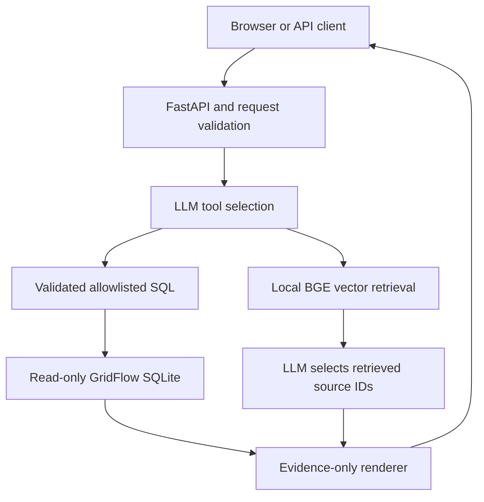

# Energy AI Copilot

An evidence-bound assistant for Great Britain's **2024 NESO electricity-demand data**.
OpenAI function calling selects allowlisted SQLite analyses or local dense document retrieval.
A second, retrieval-augmented model call selects supporting document IDs; the application
quotes those excerpts exactly. Numerical answers are rendered directly from SQL results.

This is a deliberately **extractive RAG** application, not a free-form chatbot. The LLM
cannot supply numerical values, write SQL, alter data or invent citation text. It can still
choose the wrong tool or an irrelevant source: inspect the evidence returned with every answer.

Built separately on [GridFlow](https://github.com/Abir-Ahmad/gridflow-energy-pipeline),
without changing that repository. The original validator and loader are installed at commit
`fa347cdbae1af2d22a5f300f69e22a2844b7c304`; no parallel ingestion pipeline was written.

## Verification status

- Real official CSV: **17,568 rows**, matching GridFlow's SHA-256; fresh ingestion completed.
- **42 local tests passed**, including one real BGE embedding integration test.
- **6/6 numerical component cases** and **6/6 expected-document hit@3 cases** passed.
- **62 independent CSV reconciliations** passed: 12 monthly groups and 50 period groups.
- Original GridFlow's **21 tests** were separately rerun and passed.
- **Live OpenAI calls: not run**; no API credential was available. Mocked SDK/API tests do
  not prove model routing, refusal, relevance selection or real service compatibility.
- CI and Docker status: see [verification](docs/verification.md). A Dockerfile alone is not a tested deployment.
- No hosted service, production users, forecast performance or general accuracy claim.

[Machine-readable evaluation](evidence/evaluation.json) · [test output](evidence/pytest.txt)

## Supported questions

- Which month had the highest average electricity demand?
- What was the highest recorded national demand? (All tied records are returned.)
- How does national demand vary across settlement periods?
- What was average transmission demand in August?
- What do the embedded wind and solar columns mean?
- What are the assumptions, data limitations and clock-change caveats?

Available measures: ND, TSD, embedded wind generation and embedded solar generation.
Available analyses: monthly ranking, maximum with settlement key, period-index profile,
count/mean/min/max summary; optional month filter. No prices, forecasting, causal inference,
total GB wind/solar generation, unrestricted SQL, or data outside 2024.

## Windows PowerShell: run locally

Install Python **3.12** and Git. Commands avoid virtual-environment activation:

```powershell
git clone https://github.com/Abir-Ahmad/gridflow-energy-ai-copilot.git
cd gridflow-energy-ai-copilot
py -3.12 -m venv .venv
.\.venv\Scripts\python.exe -m pip install -r requirements.lock
.\.venv\Scripts\python.exe -m pip install --no-deps -e .
.\.venv\Scripts\python.exe -m pip install "gridflow-energy-pipeline @ git+https://github.com/Abir-Ahmad/gridflow-energy-pipeline.git@fa347cdbae1af2d22a5f300f69e22a2844b7c304"
.\.venv\Scripts\python.exe scripts/setup_data.py
.\.venv\Scripts\python.exe scripts/warm_embeddings.py
.\.venv\Scripts\python.exe -m uvicorn energy_copilot.api:app --host 127.0.0.1 --port 8000
```

Open **http://127.0.0.1:8000**. The monthly SQL and document-search buttons work without
paid API access. First embedding use downloads a public model; later use reuses its local
cache. The SQLite database is under `data/`, and original GridFlow snapshots/reports under
`artifacts/gridflow/`. Setup refuses unreviewed CSV revisions instead of changing expected results.
An existing matching CSV can be supplied with `--csv C:\path\demanddata_2024.csv`.

To reuse your existing GridFlow database, skip setup and set
`$env:COPILOT_DB = "C:\path\full_2024.db"` before starting the server. Do not run ingestion
against a database while the copilot serves requests. The app reads it using SQLite `mode=ro`
and `PRAGMA query_only=ON`. Only the separate GridFlow ingestion command writes data.

### Enable natural-language LLM routing securely

Minimum requirement: an OpenAI API key with Responses API access to the configured model
and **existing usable credits/quota**. No billing or credit purchase is part of this project.
If that access is unavailable, use the direct tools and leave live verification pending.
Do not paste keys into chat, code, screenshots or Git. In PowerShell 7, set it privately:

```powershell
$env:OPENAI_API_KEY = Read-Host "OpenAI API key (hidden input)" -MaskInput
$env:OPENAI_MODEL = "gpt-4.1-mini-2025-04-14"
```

On Windows PowerShell 5.1:

```powershell
$secret = Read-Host "OpenAI API key" -AsSecureString
$env:OPENAI_API_KEY = [System.Net.NetworkCredential]::new("", $secret).Password
Remove-Variable secret
```

Restart the server from that terminal. The key is used on the backend, never sent to the browser.
`.env.example` documents settings but is **not auto-loaded**. To clear the key:
`Remove-Item Env:OPENAI_API_KEY`. Questions and retrieved excerpts go to OpenAI in live mode;
requests use `store=False`. Do not send sensitive information. API calls are bounded to one
routing call and at most one source-selection call, with 25-second timeouts and no automatic retries.

## API examples

```powershell
Invoke-RestMethod -Uri http://127.0.0.1:8000/tools/analyse -Method Post -ContentType "application/json" -Body '{"metric":"national_demand_mw","analysis":"monthly","month":null}'
Invoke-RestMethod -Uri http://127.0.0.1:8000/tools/search -Method Post -ContentType "application/json" -Body '{"query":"What does embedded wind generation mean?"}'
Invoke-RestMethod -Uri http://127.0.0.1:8000/ask -Method Post -ContentType "application/json" -Body '{"question":"What was the highest national demand in 2024?"}'
```

`/docs` provides interactive schemas. Responses contain `answer`, SQL `evidence`, document
`sources`, `mode`, `model` and `limitations`. Invalid input: HTTP 422. Invalid model output:
502. Missing database, missing key or service failure: 503. `/health` is liveness only.

## Architecture



The direct-tool endpoints bypass the LLM. The eight reviewed source notes are chunked with
100-word windows and 20-word overlap. BGE-small produces 384-dimensional dense vectors;
NumPy computes exact cosine similarity. An in-memory index is enough for this tiny corpus.
The default 0.60 similarity cutoff is a heuristic, not a calibrated probability. Sources are
content-hashed and linked to NESO or the exact GridFlow commit. See [provenance](docs/provenance.md).

## Tests and evaluation

```powershell
.\.venv\Scripts\python.exe -m pytest -q -m "not integration"
.\.venv\Scripts\python.exe -m pytest -q
.\.venv\Scripts\python.exe scripts/evaluate.py --csv data/demanddata_2024.csv
# Only with privately configured existing API access; this makes real API requests:
.\.venv\Scripts\python.exe scripts/evaluate.py --live --csv data/demanddata_2024.csv --output artifacts/live-evaluation.json
```

The first test command needs no model download or API. The full suite uses the public embedding
model. The component evaluation calls the **expected tools directly**; it does not measure
natural-language routing. `--live` tests the actual model path and four refusal cases. It exits
nonzero on failed checks. This small authored set is regression evidence, not a held-out benchmark.

## Docker

Prepare `data/energy.db` using the steps above first. With Docker Desktop running:

```powershell
docker build -t energy-ai-copilot .
docker run --rm -p 127.0.0.1:8000:8000 --mount "type=bind,source=$((Get-Location).Path)\data,target=/data,readonly" --mount "type=volume,source=energy-embeddings,target=/home/appuser/.cache/fastembed" -e OPENAI_API_KEY -e OPENAI_MODEL energy-ai-copilot
```

The container runs as a non-root user; the data mount is read-only. First documentation search
needs internet for model weights. `requirements.lock` pins the tested environment's dependencies;
Python 3.12 is the reproducibility target. The CI Docker smoke uses the real four-row fixture,
checks the SQL endpoint, and labels that fixture separately from full-year evidence.

This is a local portfolio application. Before exposing it publicly, add authentication,
rate limits, request budgets and operational monitoring. A Docker build is packaging, not hosting.

## Learn and explain it

1. [Beginner guide](docs/beginner_guide.md)
2. [Practical learning checkpoints](docs/learning_checkpoints.md)
3. [CV evidence and interview questions](docs/cv_evidence.md)
4. [Evaluation and limitations](docs/evaluation.md)

The model choice uses the documented GPT-4.1 mini snapshot with function calling:
[model documentation](https://developers.openai.com/api/docs/models/gpt-4.1-mini) and
[function calling guide](https://developers.openai.com/api/docs/guides/function-calling).
Local embeddings use [FastEmbed](https://qdrant.tech/documentation/embeddings/fastembed/).
